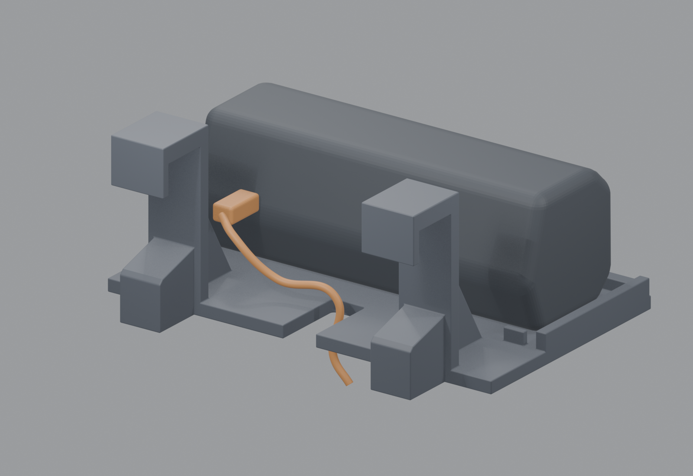

# Sonos Roam TV rail shelf

A horizontal speaker shelf that lowers onto an exposed upper TV-mount rail.
The platform, two hooks, and braces print as one continuous part. Installation
uses no screws, separate hooks, or straps.



## Versions

| Version | Rear support reach | Status | A1 slicer estimate |
| --- | --- | --- | --- |
| [V1](v1/) | 4 mm pads | Printed and used; rail fit worked, but excessive forward tilt was reported. | 5 h 58 min; 165.38 g |
| [V2](v2/) | 24 mm integral heels | Modeled and sliced to reduce forward rotation; physical fit is unverified. | 6 h 39 min; 183.19 g |

V2 retains V1's platform, hooks, and charging clearance. Its rear heels extend
toward the wall or recessed rail face to oppose forward rotation. Their bottoms
join the deck on the print bed. The 24 mm reach is a nominal estimate from the
installed V1 photo and existing hook geometry, not a measured mount dimension.

## Dimensions

| Feature | Dimension |
| --- | --- |
| Overall envelope, either version | 190 × 138 × 82 mm |
| Platform | 190 × 112 mm; 6 mm deck |
| Speaker orientation | Horizontal, grille facing the room |
| Rear charging bay | 35 mm from the front of the stems to the speaker's rear envelope |
| Central cable exit | 16 mm wide, open at the rear |
| Nominal hook throat | 22 mm |
| Hook width and spacing | 26 mm wide; 124 mm between centers |
| Rear hook return | 4 mm thick; 14 mm deep |

The roomy hooks require an accessible upper lip and space for the rear returns.
TV-mount profiles vary; this design is not a verified universal fit. The speaker
and cable shown in Blender are reference geometry and are excluded from the STL.

## Printing

The supplied projects target a Bambu Lab A1 with a 0.4 mm nozzle:

- Black Bambu PLA Basic, 0.20 mm layers.
- Six wall loops, 35% gyroid infill, five top and bottom layers.
- Deck bottom flat on the bed; V2's rear heels also touch the bed.
- Tree supports from the build plate under both hook returns.
- A 5 mm outer brim; Cool Plate (SuperTack) profile.

Each version includes an editable `.blend`, a millimeter STL, a Bambu Studio
project `.3mf`, a sliced `.gcode.3mf`, a preview, and a mesh validation report.
Both STLs are watertight, consistently wound, single solids. V2 also includes
its slicing report. The exported toolpaths retain the settings above.

Use 100% scale. Project filament 2 is black PLA; map it to the loaded black spool.
Review the plate and material settings for the actual printer. The sliced files
are specific to this A1/nozzle/material setup. Estimates include the slicer's
timelapse allowance and can differ from actual runtime.

## Fit and leveling

Remove supports and seat both hooks fully before placing the speaker on the
shelf. Check the empty shelf's bearing points and angle first. Neither version
has a formal load rating.

To size V2's rear heels precisely, hold V1 level with both hooks seated and
measure the extra gap behind each original rear pad. The heel reach should be
4 mm plus that gap. For example, a 20 mm gap calls for 24 mm reach. Change
`rear_heel_reach` in `source/build_v2.py` or the Blender text block accordingly.

## Source

The Blender files include a self-contained `PARAMETRIC GEOMETRY.py` text block.
It creates new shelf scenes and exports an STL beside the saved Blender file.
The `ONE` (V1) and `LEVEL` (V2) dictionaries contain the principal dimensions.
Some platform details also use explicit dimensions in the builder.

Standalone source is in `source/`. With Blender on your PATH, regenerate V2 from
the repository root using:

```sh
blender --background --factory-startup --python sonos-roam-tv-rail-shelf/source/build_v2.py
```

Use `build_v1.py` for V1. The scripts export into the corresponding version
folder and save a separate `generated_v1.blend` or `generated_v2.blend`.
The models were authored in Blender 5.2.1 LTS.

## Design references

- [SANUS VLL5 mount](https://www.sanus.com/en_US/products/tv-mounts/vll5/)
- [SANUS VLL5 technical drawing](https://www.sanus.com/assets/products/vll5/documents/VLL5_6805_002079_XXX.pdf)
- [Monoprice SlimSelect installation manual](https://downloads.monoprice.com/files/manuals/39258_Manual_190807.pdf)
- [Sonos Roam fact sheet](https://assets.sonos.com/media-kits/hardware/roam/roamfactsheet.pdf)
